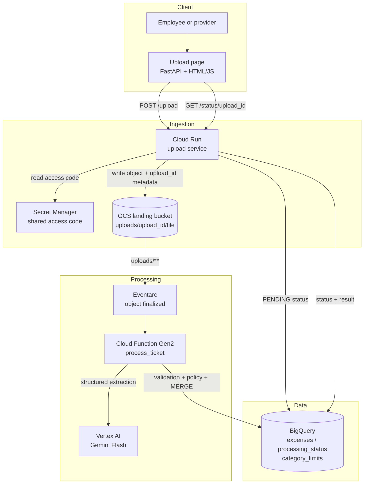

# Expense Audit Pipeline

**Serverless expense auditing on Google Cloud Platform** — upload a receipt, extract it with Gemini Flash, evaluate an explainable deterministic policy, and store the audited expense in BigQuery.

## Architecture Overview



## Components

| Component | Technology | Purpose |
|---|---|---|
| `app/upload/` | FastAPI + uvicorn | Access-code gate, upload validation, GCS write, status polling |
| `app/processor/` | Cloud Function Gen2 (Python 3.12) | Idempotent processing: extraction, policy, BigQuery MERGE |
| `src/expense_audit/domain/` | Pure Python | Models, RFC/amount validation, deterministic policy engine |
| `src/expense_audit/adapters/` | Google Cloud SDKs | Gemini, BigQuery, GCS, Secret Manager boundaries |
| `infra/` | Terraform | APIs, bucket, BigQuery, Cloud Run, Function, IAM, secret |
| `scripts/` | Python + Bash | Synthetic sample generator and end-to-end demo |
| `samples/` | Synthetic PDFs | Six demo receipts covering each policy outcome |

## Technology Stack

| Layer | Technology |
|---|---|
| Language | Python 3.12 |
| API | FastAPI, uvicorn, Jinja2 |
| LLM | Vertex AI Gemini Flash (`gemini-2.5-flash`), structured JSON schema |
| Eventing | Eventarc Cloud Storage finalized trigger |
| Compute | Cloud Run (upload) and Cloud Functions Gen2 (processor) |
| Storage | Google Cloud Storage (90-day lifecycle) |
| Analytics | BigQuery (partitioned and clustered tables) |
| Secrets | Secret Manager |
| Infrastructure | Terraform (`hashicorp/google ~> 6.0`) |
| Tests | pytest (92 tests), ruff |

## Project Structure

```
expense-audit-pipeline/
├── app/
│   ├── upload/                  # FastAPI service, templates, static assets, Dockerfile
│   └── processor/               # Cloud Function Gen2 entrypoint
├── src/expense_audit/
│   ├── domain/                  # Pure models, validation, policy engine
│   ├── adapters/                # Gemini, BigQuery, GCS, Secret Manager
│   ├── config.py                # Environment configuration
│   └── processor.py             # Processing orchestration
├── infra/                       # Terraform
│   ├── apis.tf                  # API enablement
│   ├── storage.tf               # Landing + function-source buckets
│   ├── bigquery.tf              # Dataset, tables, seed MERGE
│   ├── cloud_run.tf             # Upload service
│   ├── cloud_function.tf        # Processor + Eventarc trigger
│   ├── secrets.tf               # Access code
│   └── iam.tf                   # Least-privilege service accounts
├── tests/
│   ├── unit/                    # Domain and adapter tests
│   └── integration/             # Processor and upload tests with fakes
├── samples/                     # Six synthetic invoice PDFs
├── scripts/                     # generate_samples.py, e2e_demo.sh
├── docs/superpowers/specs/      # Approved design
├── odd/tasks/                   # Feature document and evidence log
└── .github/workflows/ci.yml     # Lint and test only
```

## Key Features

- **Explainable policy** — the LLM extracts; deterministic rules decide. Every outcome carries reason codes and machine-readable details.
- **Idempotent processing** — BigQuery `MERGE` on `source_object`, `COMPLETED` short-circuit, and a five-attempt guard against retry storms.
- **Failure isolation** — document-level failures are recorded and swallowed; infrastructure failures propagate so Eventarc retries.
- **Least-privilege IAM** — separate uploader and processor service accounts; no API keys in code.
- **Validated uploads** — access code, 10 MB cap, extension plus magic-byte checks, filename sanitization, and per-instance rate limiting.
- **Bounded cost** — scale-to-zero compute, GCS lifecycle expiry, BigQuery free tier, and cents per demo run.
- **Demo UI in Spanish** — access code, drag-and-drop upload, two-second polling, and a result card with `VÁLIDO`, `SOSPECHOSO`, or `NO DEDUCIBLE`.

## Architecture Decisions

| Decision | Why |
|---|---|
| Gemini Flash via Vertex AI | Multimodal PDF/image input, structured output, service-account auth without API keys |
| Deterministic policy engine | The model never decides policy; every result is reproducible and explainable |
| Cloud Functions Gen2 | Native GCS event trigger through Eventarc with container-based Python 3.12 |
| Proxied uploads through Cloud Run | Centralized access-code, MIME, and size validation before GCS |
| `processing_status` in BigQuery | UI polling without Firestore; one data store for the demo |
| `MERGE` on `source_object` | Duplicate Eventarc deliveries and retries cannot create a second row |
| Partition by `DATE(created_at)` | Ingestion time always exists; `expense_date` can be missing |
| Local Terraform state | Reproducible single-user demo; a commented GCS backend is included |
| Deferred Looker Studio | The data model supports views later without pipeline changes |

## Prerequisites

- Python 3.12+
- Terraform 1.6+
- Docker
- `gcloud` authenticated against a project with billing enabled
- Permissions to enable APIs and create service accounts

```bash
gcloud auth login
gcloud auth application-default login
gcloud config set project YOUR_PROJECT_ID
gcloud auth configure-docker us-central1-docker.pkg.dev
```

## Quick Start

> **Note**: Local tests and sample generation need no cloud credentials. Deployment requires an authenticated GCP project.

### 1. Local environment

```bash
make install     # creates .venv and installs the package with dev extras
make test        # 92 tests
make lint        # ruff check + format check
make samples     # regenerates the six synthetic PDFs
```

### 2. Deploy the Artifact Registry repository

The upload image does not exist on the first apply, so create the repository first:

```bash
cp infra/terraform.tfvars.example infra/terraform.tfvars
# edit project_id, access_code, and optionally company_rfc
terraform -chdir=infra init
terraform -chdir=infra apply \
  -target=google_artifact_registry_repository.upload \
  -var-file=terraform.tfvars
```

### 3. Build the image and function source

```bash
make build
```

This pushes the Cloud Run image and assembles `build/processor/` for the function source.

### 4. Apply the full stack

```bash
make deploy
terraform -chdir=infra output
```

Terraform seeds `category_limits` with an idempotent `MERGE`, so re-applies are safe.

### 5. Run the demo

Open the `upload_url` output, enter the access code, and upload a file from `samples/`.

```bash
UPLOAD_URL="$(terraform -chdir=infra output -raw upload_url)" \
ACCESS_CODE="your-demo-access-code" \
PROJECT_ID="your-project-id" BQ_DATASET="expense_audit" \
make e2e
```

## Demo Flow

1. Open the Cloud Run URL.
2. Enter the shared access code.
3. Drag and drop a PDF, PNG, or JPEG receipt.
4. The page shows `Procesando...` and polls `/status/{upload_id}` every two seconds.
5. On completion, the result card shows RFC emisor, total, category, a policy badge, and translated reasons.
6. On failure, the page shows the machine-readable error code with a clear message.

Expected sample outcomes are documented in [`samples/README.md`](samples/README.md). The noisy variant is a controlled case: the e2e script accepts a completed extraction or `EXTRACTION_FAILED`.

## Policy Rules

| Non-deductible | Suspicious |
|---|---|
| `INVALID_RFC` | `TOTAL_MISMATCH` |
| `NON_DEDUCTIBLE_CATEGORY` | `DATE_IN_FUTURE` |
| `RECEPTOR_NOT_COMPANY` | `INVALID_AMOUNT` |
| `MISSING_CRITICAL_FIELDS` | `PER_EXPENSE_LIMIT_EXCEEDED` |
| | `MONTHLY_BUDGET_EXCEEDED` |
| | `DUPLICATE_EXPENSE` |
| | `CURRENCY_UNSUPPORTED` |

Precedence: any non-deductible finding wins; otherwise any suspicious finding; otherwise `VALID`. Limits are seeded per category in MXN. Non-MXN expenses skip amount rules.

## Data Model

| Table | Purpose |
|---|---|
| `expenses` | One row per `source_object`, partitioned by `DATE(created_at)`, clustered by `policy_status, category` |
| `processing_status` | `PENDING → PROCESSING → COMPLETED \| FAILED`, attempts capped at 5 |
| `category_limits` | Per-expense and monthly limits per category, seeded by Terraform |

All writes use DML (`INSERT`/`MERGE`), so the status endpoint reads immediately consistent data.

## Running Tests

```bash
make test                                  # pytest
make lint                                  # ruff check + format check
terraform -chdir=infra validate
terraform -chdir=infra fmt -check -recursive
```

Unit tests cover validation boundaries and every policy reason code. Integration tests use in-memory fakes for GCS, BigQuery, Gemini, and Secret Manager, and cover idempotency, retry exhaustion, failure swallowing, and upload responses `401`/`413`/`400`/`202`.

## Troubleshooting

| Symptom | Cause | Fix |
|---|---|---|
| Cloud Run revision fails to start | Image missing or wrong tag | Run `make build`; confirm `upload_image` points to the pushed tag |
| Function never triggers | Eventarc filter mismatch | Confirm the trigger filters the landing bucket; the processor enforces the `uploads/` prefix in code. Check `roles/eventarc.eventReceiver` |
| `EXTRACTION_FAILED` repeatedly | Vertex AI API disabled or model unavailable | Enable `aiplatform.googleapis.com`; verify the model in the configured region |
| `terraform plan` fails on function source | `build/processor` missing | Run `make build` before `terraform apply` |
| No rows in BigQuery | Document failure recorded | Check `processing_status.error_code` and Cloud Function logs |
| Upload returns `503` | Secret Manager access failed | Verify the secret exists and `sa-uploader` has `secretAccessor` |
| Upload returns `429` | Per-instance rate limit reached | Wait an hour or raise `rate_limit_per_hour` |

## Roadmap

- [x] Event-driven upload, extraction, policy, and BigQuery persistence
- [x] Deterministic policy engine with regression tests
- [x] Terraform infrastructure and least-privilege IAM
- [x] Spanish demo UI and synthetic sample set
- [ ] Looker Studio dashboard and BigQuery views
- [ ] Email or webhook alerting
- [ ] Multi-user authentication

## License

MIT

---

Built with [FastAPI](https://fastapi.tiangolo.com), [Google Cloud Run](https://cloud.google.com/run), [Cloud Functions](https://cloud.google.com/functions), [Vertex AI](https://cloud.google.com/vertex-ai), [BigQuery](https://cloud.google.com/bigquery), [Terraform](https://www.terraform.io) and [Gemini](https://deepmind.google/technologies/gemini/).
